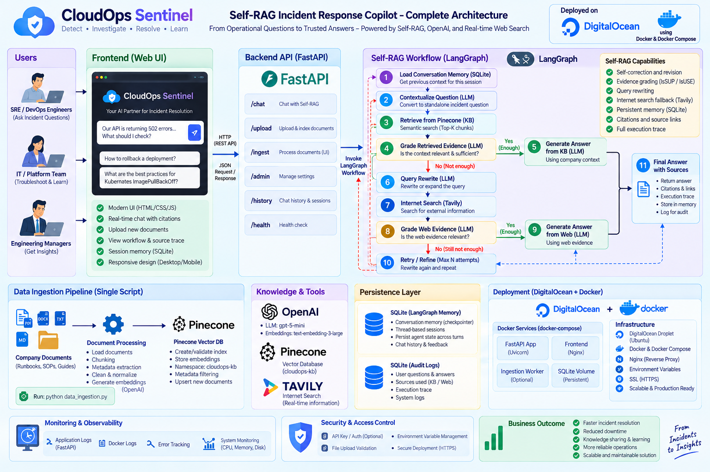

# CloudOps Sentinel



**An evidence-led incident response copilot that turns operational knowledge into traceable troubleshooting guidance.**

CloudOps Sentinel is a production-style Self-RAG project for cloud operations. It searches private runbooks in Pinecone, checks whether the retrieved material is relevant, verifies whether its answer is supported, and evaluates whether that answer helps with the incident. When internal evidence falls short, the workflow rewrites the query and can search the web through Tavily. LangGraph checkpoints preserve incident context across follow-up questions.

The project pairs that workflow with a Next.js command center for investigations, source inspection, saved conversations, activity history, and administrator-controlled knowledge uploads. It demonstrates the system design; it does not claim a production deployment or measured incident reduction.

## Why this project matters

During an incident, an engineer needs an actionable next step **and a reason to trust it**. A chatbot may answer from general knowledge even when the organization has a specific rollback procedure or service runbook. CloudOps Sentinel makes the evidence path explicit:

- **Private knowledge first.** Incident questions search the configured Pinecone namespace before external search.
- **Self-correction.** Relevance, answer support, and usefulness checks can trigger query rewrites or answer revision.
- **Honest fallback.** Web results are labeled as external guidance; if evidence remains insufficient, the workflow declines to recommend an action.
- **Incident continuity.** A stable `thread_id` restores LangGraph context for follow-ups such as “What should I check next?”
- **Inspectability.** The UI exposes sources, route, support status, and the workflow decision trace; persistent storage keeps conversation and audit records.

## How it works

1. **Understand the incident.** LangGraph loads the thread checkpoint. An LLM turns a context-dependent follow-up into a standalone question.
2. **Choose a route.** Incident and evidence-seeking questions enter retrieval. Generic technical questions may receive a direct answer.
3. **Search internal knowledge.** Pinecone retrieves runbook chunks using OpenAI embeddings. An LLM grades each chunk for relevance.
4. **Correct weak retrieval.** If no useful internal material is found, the graph rewrites the search query and retries within configured limits. It then moves to Tavily web search when needed and grades those results too.
5. **Verify the answer.** Generation uses the selected evidence. An `IsSUP` check tests grounding and can trigger revision; an `IsUSE` check tests whether the answer addresses the question and can trigger another retrieval path.
6. **Persist the result.** The graph commits the exchange to a checkpoint. A separate audit store records the answer, route, sources, trace, and thread history for the UI. Both stores use SQLite locally or hosted Postgres when `DATABASE_URL` is set.

The diagram above shows the intended end-to-end architecture. The repository currently includes a Dockerfile for the API; deployment infrastructure shown in the diagram is architectural context rather than a deployment configuration in this repo.

## What I built

| Area | Implementation |
| --- | --- |
| Self-RAG orchestration | LangGraph state machine with conditional routing, bounded rewrites, grounding revision, usefulness checks, and a safe no-evidence outcome |
| Private knowledge pipeline | PDF, TXT, Markdown, and DOCX loading; chunking; OpenAI embeddings; Pinecone index and namespace management |
| Shared retrieval configuration | Initial ingestion and live uploads use the same embedding model, index, namespace, and ingestion code |
| Persistent investigations | LangGraph checkpoints plus a separate audit database for complete answers, sources, traces, and saved threads; SQLite locally or Postgres on Vercel |
| Command center | Next.js, React, TypeScript, and Tailwind interface for questions, source inspection, history, and knowledge uploads |
| API and access control | FastAPI endpoints; bearer-token protection for uploads; file type and 10 MB size checks |

### Engineering details

- `data_ingestion.py` builds the initial knowledge base from `documents/`; the upload endpoint uses the same `src/ingestion.py` pipeline for new files.
- Ingestion assigns content-derived chunk IDs, so reprocessing the same document and content targets the same vector IDs.
- `src/vectorstore.py` creates the Pinecone index when absent and rejects an existing index whose dimension differs from the configured embedding dimension.
- The browser stores only the active thread ID. Full saved responses and decision traces are restored from the API.
- Uploads are disabled until a 32-character-or-longer administrator token is configured. The frontend forwards that token only for the upload request.

## Technology

- **AI and retrieval:** LangGraph, LangChain, OpenAI `gpt-5-mini`, OpenAI `text-embedding-3-large`, Pinecone, Tavily
- **Application:** FastAPI, Next.js, React, TypeScript, Tailwind CSS
- **Persistence and packaging:** SQLite, Postgres, Docker

The default embedding dimension is **3072**. The default Pinecone index is `cloudops-sentinel-openai-self-rag`, with namespace `incident-runbooks`.

## Explore the implementation

```text
app.py                         FastAPI chat, upload, health, audit, and history endpoints
data_ingestion.py              One-command initial knowledge ingestion
src/self_rag.py                LangGraph workflow, graders, routing, and checkpointing
src/ingestion.py               Document loading, splitting, and stable chunk IDs
src/vectorstore.py             Shared embeddings and Pinecone configuration
src/db.py                      SQLite/Postgres audit and saved-thread queries
frontend/                     Next.js incident command center and API proxy
documents/                    Example operational runbooks and rollback SOP
tests/                        Chat-history and upload-security checks
docs/architecture_diagram.png  Architecture overview
```

## See it in action

| Scenario | What the project demonstrates |
| --- | --- |
| “The checkout API is returning 502 errors after deployment. What should I check first?” | Retrieval from a private runbook, relevance grading, a grounded response, and visible sources |
| “What should I check next if that doesn't work?” | Contextualization of a follow-up using the same persisted `thread_id` |
| Upload a new runbook, then ask about its procedure | Administrator-controlled ingestion into the existing Pinecone namespace |
| Ask about a technical issue outside the runbooks | Internal retry followed by labeled internet-search guidance when useful evidence is available |

## Run locally

This project requires OpenAI and Pinecone credentials; Tavily is needed for internet fallback. Copy `.env.example` to `.env` and set `OPENAI_API_KEY`, `PINECONE_API_KEY`, and `TAVILY_API_KEY`. Set `KNOWLEDGE_UPLOAD_TOKEN` to a strong token of at least 32 characters to enable UI uploads.

```bash
python -m venv .venv
source .venv/bin/activate
pip install -r requirements.txt
python data_ingestion.py
uvicorn app:app --reload --port 8080
```

In another terminal:

```bash
cd frontend
npm install
npm run dev
```

Open **http://localhost:3000**. On Windows, activate the environment with `.venv\Scripts\activate`. The frontend proxies API requests to `http://127.0.0.1:8080` by default; `CLOUDOPS_API_URL` overrides that address.

## Scope and next steps

SQLite makes local thread persistence easy to inspect. On Vercel, set `DATABASE_URL` to hosted Postgres so LangGraph checkpoints and audit history survive function restarts; uploaded files are processed from temporary storage and indexed in Pinecone. A public deployment also needs stronger identity and access controls, operational telemetry, and evaluation against a representative incident set. The LLM-based grading steps are safeguards, not guarantees of correctness; engineers should verify actions against the cited runbook and their live environment.
